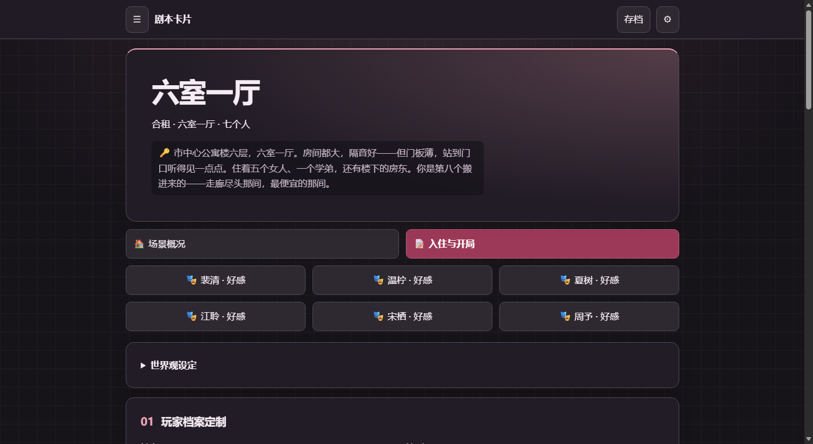
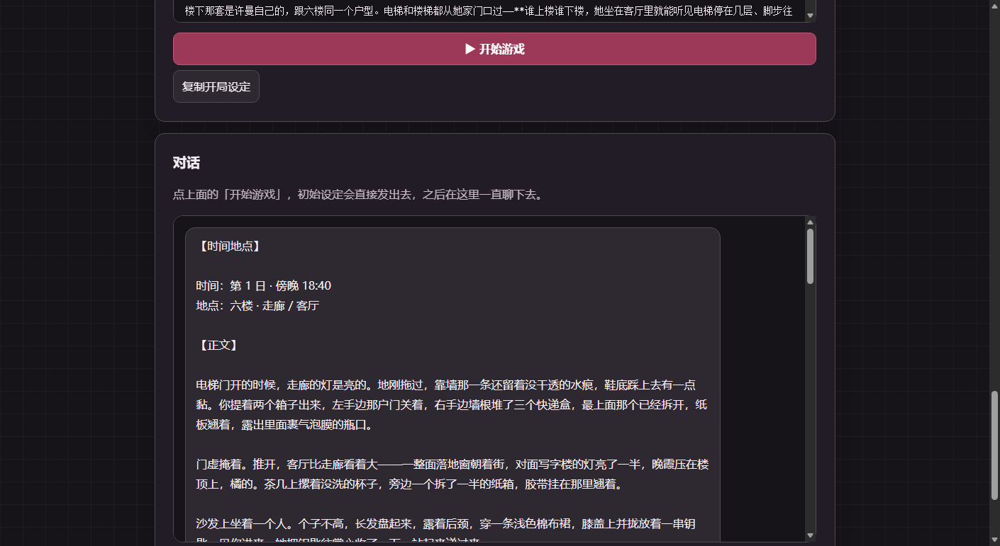
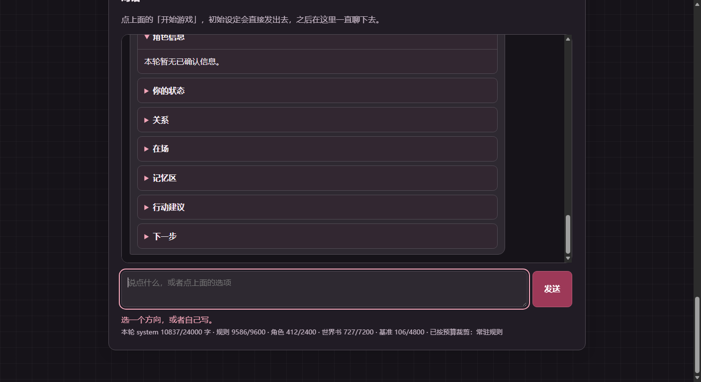

# 本地互动小说引擎

> **你可以自由打造自己的世界，用小说故事的模式玩法。**
>
> AI 角色扮演 · 互动小说 · 视觉小说 · 文字冒险 · 网文与同人二创 · 本地部署 · 零依赖

厌倦了处处受限的对话、被「净化」过的剧情、写到关键处就开始镜头一转？

这套引擎跑在你自己机器上。它不审查、不回避、不替你按下淡出。世界怎么写就怎么演，尺度由**剧本**决定，不由平台决定。



| 写世界，选一条开局 | 跑起来的样子 |
|---|---|
|  |  |


---

## 它是什么

一台本机的**互动小说引擎**。你写世界、写角色、写数值，它把这一切编译成一份模型能照着执行的提示词；然后你把它粘进任何对话窗口，故事就开始跑。

不是聊天玩具。它有三层账：

| 层 | 管什么 |
|---|---|
| **剧本** | 世界观、角色、好感数值、开局路线、尺度条款 |
| **编译器** | 把剧本编译成系统提示词，按上下文预算分四区装配，角色再多也不爆 |
| **聊天台** | 每轮输出结构化面板、数值落账、16 槽存档、跨设备共用 |

---

## 三个不妥协的地方

**① 角色不设上限**

旧版本卡在 6 个人。现在没有这个数了——**你想放多少人放多少人**。

角色可以分三层：`cast`（有数值、反复出场）、`support`（有完整档案、偶尔登场）、`extra`（一行描述、背景板）。**这三层是可选的**——不给 `tier` 就自动算 `cast`，示例剧本里六个角色都没写这一项。每轮进镜头的人由引擎按预算裁定，不在场的角色安静待在索引里，提到名字才加载档案。

实测 2000 个角色照跑，索引自动按地点归组，装不下的明确写「另有 N 名」，不会有人凭空消失。

**② 尺度写在剧本里，不写在免责声明里**

每个角色档案带两行：

```
身体：她要什么、哪里敏感、失控时什么样、会说什么话。
条件：什么行为跨得过防线，跨过去之后怎么反应。
```

协议层再压三条：动作必须写到部位与过程（哪只手、几根、从哪个方向、进到哪一段、几下、身体怎么回执）；每场性事至少一次完整高潮，只写到「快要」算没写完；**不许淡出**——「一夜过去」「事后」「不知过了多久」全部删掉重写。

不是暗示，不是留白，不是比喻。

**③ 账本归代码，不归模型**

模型每轮只报「变了什么」，剩下的由代码合。好感、堕落、警觉、开发程度——值是数，不是形容词。骰子不会因为模型心情好就多给两分。

---

## 快速开始

**Windows**：双击 `start.cmd`

**命令行**：
```bash
node start.mjs            # 启动并打开浏览器
node start.mjs --no-open  # 只启动服务
```

浏览器打开 **http://127.0.0.1:18769/** 。关掉启动窗口即结束服务。

服务**默认只监听本机**（`127.0.0.1`）。要让同一 Wi-Fi 的手机连进来，显式加参数：

```
node start.mjs --lan
```

`--lan` 会绑 `0.0.0.0`，并在启动时打印手机能用的地址。**开了之后，同一 Wi-Fi 下的任何人都能打开那个地址、读你的存档**（存档是明文 JSON，没有密码）。不用的时候别开着——不开 `--lan`，局域网地址一律连不上，这是默认行为。

需要 **Node 20 或更高**，零依赖，不用 `npm install`。

---

## 接上模型

引擎自己不写正文，它把提示词交给你。想让界面里直接对话，填上你自己的 API key：

1. 启动后点右上角 **⚙**
2. 在「模型」里填三样：
   - **API 地址** — 默认 `https://api.deepseek.com/v1/chat/completions`；换供应商就填它的兼容地址（OpenAI、Groq、任何 OpenAI 兼容端点）
   - **API Key** — 你自己的 key
   - **目标模型** — `deepseek-chat` / `deepseek-reasoner`，或点「自定义模型名…」手填
3. 点「测试连接」，看到「连接正常」就能开始

**key 存在哪：** 只存在这台设备的浏览器里（`localStorage`）。

**服务端不持有它：** 不读环境变量、不读 `~/.dsh`、不读 `.env`、不扫盘找 `sk-` 开头的串。程序启动后不会主动去获取任何凭据，也不会因为找不到而失败——它只在你按下发送时，把这一次请求转给上游，用完即弃。

换浏览器、换设备、清一次缓存，都要重新填。这是代价，也是它不会跟着仓库流出去的原因。

**不给 key 也能用**：点「编译」，把右边那段提示词整段复制，贴进任何对话窗口——GPT、Claude、Gemini、Grok 都行。存档与面板照常工作，只是需要你手动粘贴。

---

## 自带的那个剧本

**《六室一厅》**

市中心一栋楼，六层整层六个房间，一人一间。靠电梯那头原本是储藏室，后来改成第七间——归你，窗户朝街背面，整层最便宜。楼下住着房东许曼，电梯和楼梯都从她门口过，谁上楼谁下楼她听得出来。

六个人各有各的作息：半夜回家喝到第三杯话才变多的律师、笑得越甜越可能是装的的大二学生、白天一场晚上十一点换号另一场的主播、刚分手回家会突然不说话的英语老师、三十万粉的十二线小明星、还有一个暗恋着走廊另一头却从不开口的男生。

剧本 JSON 在 `scripts/rent-room.json`。它演示了这套格式的完整用法：7,261 字的世界观规则（含「墙是厚的，门不厚」这类能直接执行的物理约束）、六个角色档案（每人带 `身体：` 与 `条件：` 两行）、三条开局路线（两条预设 + 一条自己写）、六段状态栏面板、1,616 字的每轮面板协议。

想改就改。想换成别的世界，照它的骨架另写一份。

---

## 造一个自己的世界

1. **复制** `scripts/rent-room.json`，改成新文件名，`id` 填一个唯一值。
2. **写世界**：`setting.rule` 放这个世界不可动摇的规则。写在那儿的东西每轮都会进上下文，所以只放真规则，别放设定集。
3. **写角色**：每人 `profile` 分三段——身份与外形、`身体：`、`条件：`。想要一个会自己动的角色，这两行必须有。
4. **给数值**：每位 1–4 个，0–100。阶位、堕落、警觉、开发程度都行，名字随你起。
5. **排路线**：至少一条预设 + 一条排在最后的自由路线。预设路线的 `stats` 按角色 ID 给初值；自由路线不给，让模型按场景推。
6. **注册**：把文件名加进 `scripts/index.json`，刷新页面。也可以在剧本库里直接导入 JSON。

写完点「编译」，右边就是可以直接整段复制走的提示词。

---

## 用哪个模型都行

引擎产出的是纯文本提示词——**GPT、Claude、Gemini、Grok、DeepSeek**，谁接得住长上下文就用谁。

差别在脾气，不在能力：

- **Claude** 文笔最稳，长线不乱，但需要你把尺度条款写得更硬
- **GPT** 指令遵循最好，面板格式最不容易跑偏
- **DeepSeek** 中文最有味，成本最低，适合长篇连载
- **Gemini / Grok** 上下文大，适合角色特别多的世界

同一份剧本换个模型，人物的性格会变——这是好事，多试几个找到你想要的语气。

---

## 存档

对话区的存档由**跑服务的那台机器**保管，共 16 个槽位。手机和电脑连同一个服务时共用，一台写入后另一台点「刷新槽位」就能看到。

存档文件在 `data/shared-saves/`。换机器就整个目录拷过去。

浏览器里的草稿（正在编的剧本）存在 localStorage，按设备隔离。要迁移用剧本库的导出/导入。

---

## 给开发者

```bash
node --test          # 59 项测试，10 个文件
```

零运行时依赖。核心在 `compiler.mjs`（编译与预算装配）和 `lib/`（角色调度、上下文切分、账本合并、共享存档）。加剧本只碰 `scripts/`，别动引擎。

引擎与剧本分离——**改引擎不该让剧本需要改，加剧本不该让引擎需要改**。

---

## 你可能也在找这些

如果你是从下面这些方向搜过来的，大概对得上：

| 你在找 | 这里对应的是 |
|---|---|
| **AI 角色扮演** · Character.AI / TavernAI / SillyTavern（酒馆） | 同类定位，但世界和角色是**你自己写的 JSON 剧本**，不是平台上的卡片；不用注册，断网也能编译 |
| **AI 写小说** · 网文连载 · 同人二创 | 一次编译出完整设定加写作指令，整段粘给 GPT / Claude / DeepSeek 就能写长篇；账本让一百章之后的设定不崩 |
| **视觉小说** · galgame · 文字冒险 | 有数值阶梯、开局路线、状态栏面板——没有立绘和 BGM，画面交给脑内渲染 |
| **二次元** · 纸片人 · 原创角色 | 角色档案是纯文本，`身体：` 和 `条件：` 两行想写多细都行 |
| **无审查** · 不要净化 · 不回避 | 尺度写在剧本里，引擎不插手；换剧本就换尺度 |
| **本地部署** · 隐私 · 离线 | 零依赖单文件，数据全在你机器上；默认只监听本机，加 `--lan` 才让同 Wi-Fi 的手机接着玩 |
| GPT / Claude / Gemini / Grok / DeepSeek / 任意 OpenAI 兼容模型 | 编译产物就是纯提示词，粘给谁都行；也内置 DeepSeek 直连通道 |



上图底部那行是每轮的真实开销：`system 10837/24000 字 · 规则 9586/9600 · 角色 412/2400 · 世界书 727/7200 · 基准 106/4800`。四个区各自封顶，角色加得再多也挤不掉规则。

---

> 文字的挑逗已经不够了。
>
> 把世界写下来，让它自己长。

---

## 许可

MIT，见 [LICENSE](LICENSE)。

**一句实话**：这个仓库是新的，代码没有经过第三方审计。它会读写你机器上的明文 JSON（剧本与存档），并把你填的 key 转发给你填的那个地址。介意的话，读一遍 `start.mjs`——300 行，不带依赖，从 `listen` 到 `handleChat` 都是直的。
